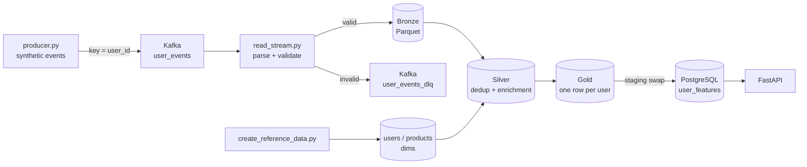

# Real-Time Personalization Pipeline

A local data pipeline for user-level personalization features, built from:

- **Streaming ingestion**: Kafka → Spark Structured Streaming → Bronze (Parquet), with validation and a dead-letter topic.
- **Batch feature computation**: Bronze → Silver → Gold → PostgreSQL.
- **API serving**: FastAPI reads the PostgreSQL feature table.

The events are synthetic. Features are computed in batch: the streaming job validates and lands events, and the batch jobs build and publish the features.

## 1. Architecture



The full diagram, including monitoring, is in [docs/diagrams/project1_system_architecture.mmd](docs/diagrams/project1_system_architecture.mmd). Component details are in [docs/architecture.md](docs/architecture.md).

| Stage | Code | Output |
|---|---|---|
| Event generation | `data-generator/producer.py` | Kafka `user_events` |
| Validation and landing | `spark-streaming/read_stream.py` (via `scripts/run_stream.sh`) | `data/bronze/user_events`, Kafka `user_events_dlq` |
| Reference data | `reference-data/create_reference_data.py` | `data/dim/users`, `data/dim/products` |
| Dedup and enrichment | `spark-batch/bronze_to_silver.py` | `data/silver/user_events` |
| User features | `spark-batch/silver_to_gold.py` | `data/gold/user_features` |
| Publish | `spark-batch/publish_gold_to_postgres.py` | PostgreSQL `user_features` |
| Serving | `api/main.py` | HTTP API |
| Orchestration (optional) | `dags/project1_personalization_pipeline.py` | Airflow DAG `project1_personalization_batch_pipeline` |
| Monitoring | `monitoring/run_monitoring.sh` | Prometheus and Grafana |

## 2. Event contract

The producer sends one JSON event per message to `user_events`, keyed by `user_id`. This event was produced by `generate_event()`:

```json
{
  "event_id": "6513270e-269e-4d37-b2a7-4de452e6b438",
  "session_id": "d23f0824-128b-4f33-8c5c-7fd0a6a3a450",
  "user_id": 2653,
  "user_name": "Alice Williams",
  "email": "aliciacamacho@example.com",
  "gender": "other",
  "age": 19,
  "membership_tier": "plus",
  "loyalty_points": 3339,
  "preferred_language": "kannada",
  "home_city": "Gomezfort",
  "home_state": "Tennessee",
  "event_time": "2026-10-27T13:02:46.354355+00:00",
  "event_type": "add_to_cart",
  "user_journey_stage": "checkout",
  "user_segment": "discount_hunter",
  "is_prime_user": true,
  "product_id": 10020,
  "product_name": "perfume",
  "category": "beauty",
  "quantity": 1,
  "original_price": 53753.08,
  "discount_percent": 63.68,
  "discounted_price": 19523.12,
  "cart_value": 19523.12,
  "inventory_remaining": 35,
  "search_query": "running shoes",
  "time_on_page_sec": 739.33,
  "scroll_depth_percent": 12,
  "hover_duration_ms": 11982,
  "session_duration_sec": 623,
  "items_viewed_in_session": 12,
  "repeat_product_view_count": 19,
  "time_since_last_event_ms": 577914,
  "recommendation_rank": 4,
  "recommendation_clicked": false,
  "recommendation_algorithm": "trending",
  "click_position": 2,
  "engagement_score": 33.73,
  "purchase_probability": 1.0,
  "cart_abandonment_probability": 0.8269,
  "ab_test_group": "A",
  "payment_method": "credit_card",
  "device_type": "tablet",
  "operating_system": "linux",
  "browser": "chrome",
  "network_type": "ethernet",
  "app_version": "1.3",
  "traffic_source": "organic",
  "campaign_id": 3181,
  "api_latency_ms": 613,
  "page_load_time_ms": 3533,
  "fraud_score": 0.1443,
  "country": "Mauritania",
  "city": "West Brandihaven",
  "ip_address": "100.11.0.81",
  "schema_version": "4.0",
  "source": "real-time-personalization-generator"
}
```

- **Users:** `user_id` is drawn from 1..`NUM_USERS`. Each user has a fixed profile (name, email, tier, segment, home city and so on), so these fields are stable per user.
- **Products:** every category has products. `product_id` is fixed per product: the sorted product names are numbered from 10000.
- **Event types the producer emits:** `product_view`, `search`, `recommendation_impression`, `recommendation_click`, `home_page_view`, `add_to_cart`, `checkout_started`, `wishlist_add`, `login`, `payment_success`, `ad_click`, `review_submitted`, `logout`.
- **Event types the stream accepts:** the 26 types in `EVENT_TYPES`. The list is defined in both the producer and the stream, and a test keeps the two in sync.

### Validation and DLQ routing

An event goes to Bronze only if all of these hold. Otherwise its original JSON string is written to the Kafka topic `user_events_dlq`.

- **Required fields:** `event_id`, `session_id`, `user_id`, `event_type`, `product_name`, `discounted_price`, `event_time`, `source` and `schema_version` are present.
- **Timestamp:** `event_time` parses to a timestamp. A malformed value becomes NULL and fails the check instead of stopping the stream.
- **Identity and contract:**
  - `event_id` is not blank;
  - `event_type` is in `EVENT_TYPES`;
  - `schema_version` is `"4.0"`;
  - `user_id >= 1`.
- **Value ranges:**
  - `quantity >= 1`, `original_price >= 0`, and `0 <= discounted_price <= original_price`;
  - `0 <= discount_percent <= 100`;
  - `purchase_probability`, `cart_abandonment_probability` and `fraud_score` are each between 0 and 1.

All checks are combined into one `is_valid` column wrapped in `coalesce(..., false)`, so a NULL in any checked column, or a message that isn't valid JSON, counts as invalid instead of disappearing. Bronze keeps the 58 parsed fields plus `event_timestamp`.

## 3. Quick start

Requirements: Docker, Java 17 and Python 3.11 or newer. Run everything from the repository root.

```bash
python -m venv venv
source venv/bin/activate
pip install -r requirements-ci.txt -r api/requirements.txt
```

1. Start Kafka (`127.0.0.1:9092`) and PostgreSQL (`127.0.0.1:5433`):

   ```bash
   docker compose up -d
   ```

2. Create both topics with 3 partitions:

   ```bash
   docker exec kafka /opt/kafka/bin/kafka-topics.sh --bootstrap-server localhost:9092 --create --if-not-exists --topic user_events --partitions 3 --replication-factor 1
   docker exec kafka /opt/kafka/bin/kafka-topics.sh --bootstrap-server localhost:9092 --create --if-not-exists --topic user_events_dlq --partitions 3 --replication-factor 1
   ```

3. Start the stream in its own terminal. Stop it with Ctrl+C.

   ```bash
   scripts/run_stream.sh
   ```

   The script runs `spark-submit --packages org.apache.spark:spark-sql-kafka-0-10_2.13:4.1.2 spark-streaming/read_stream.py`.

4. Produce events in another terminal. Stop with Ctrl+C; it prints a `delivered / failed / undelivered` summary.

   ```bash
   python data-generator/producer.py
   ```

5. Build the reference data:

   ```bash
   spark-submit reference-data/create_reference_data.py
   ```

6. Build Silver and Gold:

   ```bash
   spark-submit spark-batch/bronze_to_silver.py
   spark-submit spark-batch/silver_to_gold.py
   ```

7. Publish to PostgreSQL:

   ```bash
   spark-submit --packages org.postgresql:postgresql:42.7.4 spark-batch/publish_gold_to_postgres.py
   ```

8. Start the API:

   ```bash
   uvicorn api.main:app --host 127.0.0.1 --port 8000
   curl http://127.0.0.1:8000/health
   ```

9. Start monitoring (optional). Prometheus is at `127.0.0.1:9090` and Grafana at `127.0.0.1:3000`. `monitoring/stop_monitoring.sh` removes the containers.

   ```bash
   monitoring/run_monitoring.sh
   ```

The batch scripts use paths relative to the current directory, so run them from the repository root. `spark-batch/query_gold_features.py` runs a few example queries on Gold.

## 4. Configuration

| Variable | Default | Used by |
|---|---|---|
| `POSTGRES_HOST` | `localhost` | API, publish job, DAG verification task, feature-freshness exporter |
| `POSTGRES_PORT` | `5433` | same as above |
| `POSTGRES_DB` | `personalization_db` | same as above |
| `POSTGRES_USER` | `de_user` | same as above |
| `POSTGRES_PASSWORD` | `de_password` | same as above |
| `PROJECT1_ROOT` | the repository root, derived from the file's location | `read_stream.py` (Bronze and checkpoint paths), Airflow DAG (task working directory) |
| `NUM_USERS` | `5000` | `producer.py` and `create_reference_data.py`; set the same value for both, or users outside the users dim show as missing references |
| `SPARK_KAFKA_VERSION` | `4.1.2` | `scripts/run_stream.sh` (Spark Kafka connector version) |
| `GRAFANA_ADMIN_PASSWORD` | unset: a random 24-character password is generated and printed once | `monitoring/run_monitoring.sh` |

The feature-freshness exporter's own default host is `host.docker.internal`, but `run_monitoring.sh` starts it with `POSTGRES_HOST=localhost` and `POSTGRES_PORT=5433`. The Docker Compose file creates the database with the default name, user and password above.

## 5. Serving contract

### PostgreSQL `user_features`

| Column | Type |
|---|---|
| `user_id` | integer (PRIMARY KEY, `user_features_pkey`) |
| `user_name` | text |
| `membership_tier` | text |
| `total_events` | bigint |
| `page_view_count` | bigint |
| `product_view_count` | bigint |
| `add_to_cart_count` | bigint |
| `purchase_count` | bigint |
| `search_count` | bigint |
| `avg_event_price` | double precision |
| `max_event_price` | double precision |
| `avg_engagement_score` | double precision |
| `avg_purchase_probability` | double precision |
| `last_event_timestamp` | timestamp with time zone |
| `unique_products_interacted` | bigint |

How the columns are computed:
- **Page views and purchases:** `page_view_count` counts `page_view` and `home_page_view` events, and `purchase_count` counts `purchase` and `payment_success` events.
- **Other counts:** `product_view_count`, `add_to_cart_count` and `search_count` count those event types.
- **Name and tier:** `user_name` and `membership_tier` come from the user's latest event.
- **Prices and scores:** `avg_event_price` and `max_event_price` are rounded to 2 decimals, as is `avg_engagement_score`; `avg_purchase_probability` is rounded to 4.
- **Remaining columns:** `last_event_timestamp` is the latest event time, and `unique_products_interacted` counts distinct product names.

**Publishing is atomic.** The job writes to `user_features_staging`, then in one transaction:
1. checks that staging is non-empty and that every `user_id` is unique;
2. adds the primary key;
3. drops `user_features`;
4. renames staging to `user_features`;
5. renames the key to `user_features_pkey`.

If anything fails, the transaction rolls back and the live table stays as it was. Queries already running finish first, because the swap waits for their locks; queries that arrive during the swap wait for its brief lock and then read the new table. Readers never see a missing, empty or partially written table.

### API

| Endpoint | Status | Body |
|---|---|---|
| `GET /` | 200 | service message |
| `GET /health` | 200 | `{"status": "healthy", "postgres": "connected"}` |
| `GET /health` | 503 | `{"detail": "database unavailable"}`, `"user_features missing"` or `"user_features empty"` |
| `GET /features/{user_id}` | 200 | `{"user_id": ..., "features": {...}}` |
| `GET /features/{user_id}` | 404 | `{"detail": "No features found for user_id=<id>"}` |
| `GET /features/{user_id}` | 422 | `user_id` is not an integer |
| `GET /features/{user_id}` | 500 | `{"detail": "Feature lookup failed"}` |
| `GET /metrics` | 200 | Prometheus metrics |

`features` contains `user_id`, `total_events`, `page_view_count`, `product_view_count`, `add_to_cart_count`, `purchase_count`, `search_count`, `avg_event_price`, `max_event_price`, `last_event_timestamp`, `unique_products_interacted`, `avg_engagement_score` and `avg_purchase_probability`. Error responses never include exception text; details are logged server-side.

## 6. Operations

- **Stopping the stream:** press Ctrl+C, or `kill -TERM -<pgid>`, in the `scripts/run_stream.sh` terminal. The stream stops both queries and Spark, prints `[stream] stopped cleanly` and exits 0. The script makes the JVM ignore SIGINT/SIGTERM, so the signal reaches only the Python driver, which shuts down in order.
- **Restarting the stream:** it resumes from `checkpoints/bronze_user_events` and `checkpoints/dlq`.
- **Resetting the stream (re-reading Kafka from the start):** stop the stream, then move **both** `checkpoints/` **and** `data/bronze/user_events` out of the repository. The Bronze folder holds the file sink's own log (`_spark_metadata`). A new checkpoint paired with an old `_spark_metadata` makes the sink treat new batches as already written and skip them without an error. After a reset the DLQ query re-reads the topic too, so invalid events already in the DLQ are written there again.
- **Kafka data** lives on the `kafka_data` Docker volume and **PostgreSQL data** on `postgres_data`; both survive container recreation. Never run `docker compose down -v`: it deletes both volumes.
- **Airflow (optional):** the DAG `project1_personalization_batch_pipeline` runs daily with `max_active_runs=1`:
  `verify_bronze_exists → create_reference_data → bronze_to_silver → verify_silver_exists → silver_to_gold → verify_gold_exists → gold_to_postgres → verify_postgres_api_path`.
  Its Python dependencies are in `requirements-airflow.txt`. The tasks call `spark-submit`, so it must be on the worker's PATH.
- **Monitoring:** the Grafana dashboard covers API request rate and p95 latency, `user_events` and DLQ throughput, consumer-group lag, `user_features` row count, feature freshness and exporter health. Spark keeps its Kafka offsets in checkpoints rather than a consumer group, so the consumer-group lag panel normally shows no data; feature freshness is the signal for the batch-to-serving path.

## 7. Design decisions

- **Lossless Bronze, dedup in Silver.** Bronze keeps every valid event, including duplicates. Silver removes duplicate `event_id`s. Bronze has no streaming watermark or stateful dedup, so late events are never dropped.
- **One coalesced `is_valid`.** Every validation rule feeds a single column, defaulting to false, so each event lands in exactly one of Bronze and the DLQ.
- **Staging-table swap.** The serving table is replaced in one transaction after validation, with a stable primary-key name.
- **Reference dims from the producer.** The users and products dims come from the producer's catalog and user profiles, so every id the producer emits has a reference row. They are rebuilt on every run, and the derived columns use fixed seeds and a fixed anchor date, so the output is the same each time.
- **Spark sessions in UTC.** Every Spark job sets `spark.sql.session.timeZone=UTC`. Event times carry `+00:00`, and PostgreSQL stores `timestamp with time zone`.

## 8. Testing and CI

```bash
ruff check .
python -m pytest -q
```

The suite has 35 tests:

| File | Tests | Covers |
|---|---:|---|
| `tests/test_project_structure.py` | 3 | required files exist; runtime folders (`venv/`, `venv-airflow/`, `data/`, `checkpoints/`, `logs/`, `airflow_home/`) are git-ignored; producer and stream `EVENT_TYPES` match |
| `tests/test_python_syntax.py` | 1 | every Python file parses |
| `tests/test_feature_api.py` | 8 | API with a mocked database: found / 404 / 500 / 503 reasons, no credentials or exception text in responses, `POSTGRES_*` honored, `user_id` typed as int |
| `tests/test_producer_contract.py` | 7 | 58 keys in order, schema 4.0, known event types, unique `event_id`s, every category has products, one-to-one `product_id`s, stable profile per user; importing the producer creates no Kafka connection |
| `tests/test_stream_validation.py` | 11 | each validation rule routes to the DLQ, valid + invalid = input, Bronze/DLQ columns unchanged, importing the stream module starts no Spark |
| `tests/test_batch_pipeline.py` | 5 | the real reference, Silver and Gold scripts on a tiny Bronze: duplicate removed, event `user_segment` kept, no missing references, one Gold row per user, exact page-view and purchase counts |

GitHub Actions (`.github/workflows/ci.yml`) has two jobs:
- **Python lint and validation:** sets up Python 3.11 and Java 17 (Temurin), installs `requirements-ci.txt`, then runs `ruff check .` and `pytest -q`.
- **FastAPI Docker build validation:** builds `api/Dockerfile`.

## 9. Known limitations

- **Batch features:** features are recomputed in batch runs. The stream does not update `user_features`.
- **Full reprocessing:** every batch run reprocesses all of Bronze and rebuilds Silver, Gold and the serving table.
- **No raw payload in Bronze:** Bronze stores the parsed columns, not the raw Kafka payload. Only rejected events keep their original JSON, in the DLQ.
- **Synthetic `user_name`:** the serving table includes `user_name` (synthetic). A production feature store would serve IDs and features only, not personal fields.
- **No rejection reason in the DLQ:** DLQ messages carry the original JSON only, not which rule rejected them.
- **No connection pool:** the API opens one PostgreSQL connection per request.
- **Single Kafka broker:** one broker with replication factor 1.
- **Airflow not in the reproducible setup:** the Airflow environment isn't part of the setup above, and CI only checks the DAG's Python syntax; it doesn't run it.
- **JVM ignores INT/TERM:** `scripts/run_stream.sh` makes the JVM ignore SIGINT and SIGTERM. If the Python driver ever hangs, only SIGKILL stops the JVM.
- **Product ids can shift:** adding or renaming a product renumbers `product_id`s, because ids follow sorted product names. The dims are rebuilt on every run, so they stay in step, but events already in Bronze keep their old ids.
- **Default credentials:** PostgreSQL uses local defaults (`de_user` / `de_password`).
- **Grafana password exposure:** the Grafana admin password is passed as an environment variable and is visible through `docker inspect grafana`.
- **Floating image tags:** `postgres:16` and the `python:3.11-slim` / `python:3.12-slim` base images are tagged by major/minor version only, so they can change underneath.

## 10. License

MIT. See [LICENSE](LICENSE).
