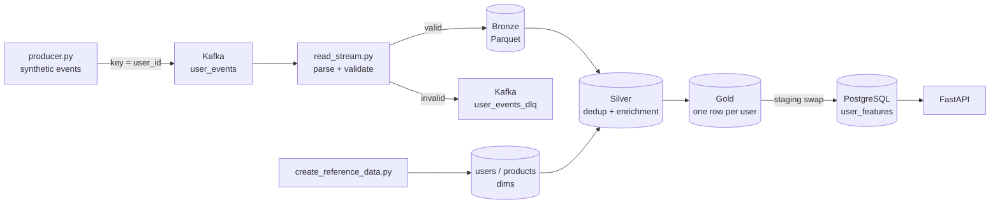

# Real-Time Personalization Pipeline

[](https://github.com/HimanshuLabs/Real-time-personalization-pipeline/actions/workflows/ci.yml)


[](LICENSE)

An end-to-end data pipeline that turns a stream of e-commerce events into per-user personalization features and serves them over an API.

**Kafka → Spark Structured Streaming → Bronze → Silver → Gold → PostgreSQL → FastAPI**, with a dead-letter topic, an atomic serving-table swap, Airflow orchestration and Prometheus/Grafana monitoring. Everything runs locally with Docker; the events are synthetic.

> Streaming ingestion lands and validates events continuously. Features are computed in batch and published atomically, so the API always reads a complete, consistent table.

## Highlights

- **No silent data loss.** Every event lands in exactly one place: Bronze if valid, the dead-letter topic if not. Malformed timestamps and NULLs are routed to the DLQ instead of crashing the stream or vanishing.
- **Lossless Bronze, dedup in Silver.** Bronze keeps every valid event; duplicates are removed by `event_id` in Silver, so no late event is ever dropped.
- **Atomic publishing.** Gold is written to a staging table, validated (non-empty, unique `user_id`) and swapped into the live table in one PostgreSQL transaction. A failed publish leaves the old table untouched.
- **Graceful operations.** Ctrl+C stops the stream cleanly in about a second, and a restart resumes from its checkpoint with no duplicates or gaps. Kafka and PostgreSQL data persist on Docker volumes.
- **Contracts enforced by tests.** 35 tests run the real Spark scripts on small datasets and check exact results, plus the event schema, validation rules and API behaviour. CI runs them on every push to `main` and on pull requests.
- **Observable.** Prometheus scrapes the API and two exporters; Grafana shows request rate, latency, Kafka throughput, DLQ rate and feature freshness.

## Architecture



| Stage | Code | Output |
|---|---|---|
| Event generation | `data-generator/producer.py` | Kafka `user_events` (3 partitions, keyed by `user_id`) |
| Validation and landing | `spark-streaming/read_stream.py` (via `scripts/run_stream.sh`) | `data/bronze/user_events`, Kafka `user_events_dlq` |
| Reference data | `reference-data/create_reference_data.py` | `data/dim/users`, `data/dim/products` |
| Dedup and enrichment | `spark-batch/bronze_to_silver.py` | `data/silver/user_events` |
| User features | `spark-batch/silver_to_gold.py` | `data/gold/user_features` |
| Publish | `spark-batch/publish_gold_to_postgres.py` | PostgreSQL `user_features` |
| Serving | `api/main.py` | HTTP API |
| Orchestration | `dags/project1_personalization_pipeline.py` | Airflow DAG `project1_personalization_batch_pipeline` |
| Monitoring | `monitoring/run_monitoring.sh` | Prometheus and Grafana |

The full diagram, including monitoring, is in [docs/diagrams/project1_system_architecture.mmd](docs/diagrams/project1_system_architecture.mmd), and component details are in [docs/architecture.md](docs/architecture.md).

## Example run

One end-to-end run, following the quick start below with three producers for 15 minutes:

| Stage | Result |
|---|---|
| Kafka `user_events` | 3,520 events across 3 partitions |
| Bronze | 3,520 rows, 3,520 distinct `event_id`s |
| Dead-letter topic | 0 events: the producer only emits valid events (rejection paths are covered by the validation tests) |
| Silver | 3,520 rows, 0 missing user or product references |
| Gold and PostgreSQL | 2,530 users, one row each; 339 page views and 139 purchases |
| API | `/health` 200; `/features/{id}` 200, 404 and 422 as specified |
| Monitoring | all Prometheus targets up; feature freshness reported |

 Counts vary from run to run, because the producer generates random events.

### See the dead-letter topic in action

With the stream running, send a malformed event and watch it land in `user_events_dlq` instead of Bronze:

```bash
echo '{"event_id":"demo-bad-1","event_time":"not-a-date"}' | docker exec -i kafka /opt/kafka/bin/kafka-console-producer.sh --bootstrap-server localhost:9092 --topic user_events
sleep 15
docker exec kafka /opt/kafka/bin/kafka-get-offsets.sh --bootstrap-server localhost:9092 --topic user_events_dlq
```

One partition of `user_events_dlq` goes up by 1.

## Tech stack

| Layer | Technology |
|---|---|
| Messaging | Apache Kafka 4.1.2 (KRaft, single broker) |
| Processing | Apache Spark 4.1.2 (Structured Streaming and batch), Parquet |
| Serving | PostgreSQL 16, FastAPI 0.115, psycopg 3 |
| Orchestration | Apache Airflow 3.2 |
| Monitoring | Prometheus 3.5, Grafana 13, kafka-exporter 1.10, custom feature-freshness exporter |
| Quality | pytest, Ruff, GitHub Actions |
| Runtime | Docker Compose, Python 3.11+, Java 17 |

## Quick start

Requirements: Docker, Java 17 and Python 3.11 or newer. Run everything from the repository root.

```bash
python -m venv venv
source venv/bin/activate
pip install -r requirements-ci.txt -r api/requirements.txt
```

1. Start Kafka (`127.0.0.1:9092`) and PostgreSQL (`127.0.0.1:5433`):

   ```bash
   docker compose up -d
   ```

2. Create both topics with 3 partitions:

   ```bash
   docker exec kafka /opt/kafka/bin/kafka-topics.sh --bootstrap-server localhost:9092 --create --if-not-exists --topic user_events --partitions 3 --replication-factor 1
   docker exec kafka /opt/kafka/bin/kafka-topics.sh --bootstrap-server localhost:9092 --create --if-not-exists --topic user_events_dlq --partitions 3 --replication-factor 1
   ```

3. Start the stream in its own terminal (stop it with Ctrl+C):

   ```bash
   scripts/run_stream.sh
   ```

4. Produce events in another terminal (stop with Ctrl+C; it prints a `delivered / failed / undelivered` summary):

   ```bash
   python data-generator/producer.py
   ```

5. Build the reference data, Silver and Gold:

   ```bash
   spark-submit reference-data/create_reference_data.py
   spark-submit spark-batch/bronze_to_silver.py
   spark-submit spark-batch/silver_to_gold.py
   ```

6. Publish to PostgreSQL:

   ```bash
   spark-submit --packages org.postgresql:postgresql:42.7.4 spark-batch/publish_gold_to_postgres.py
   ```

7. Start the API and query it:

   ```bash
   uvicorn api.main:app --host 127.0.0.1 --port 8000
   curl http://127.0.0.1:8000/health
   ```

   Then call `GET /features/{user_id}` for any `user_id` in `user_features`.

8. Start monitoring (optional). Prometheus runs at `127.0.0.1:9090` and Grafana at `127.0.0.1:3000`; `monitoring/stop_monitoring.sh` removes the containers.

   ```bash
   monitoring/run_monitoring.sh
   ```

The batch scripts use paths relative to the current directory, so run them from the repository root. `spark-batch/query_gold_features.py` runs a few example queries on Gold.

## How it works

### Streaming ingestion and validation

`scripts/run_stream.sh` starts `spark-streaming/read_stream.py` with the Spark Kafka connector (`spark-sql-kafka-0-10_2.13:4.1.2`). The stream reads `user_events` (from the earliest offset on first start, then from its checkpoint), parses each message with a typed schema and routes it every 10 seconds:

- **Valid** events are appended to Bronze Parquet with their 58 fields plus `event_timestamp`.
- **Invalid** events are written to `user_events_dlq` as their original JSON.

An event is valid only if all of these hold:

- **Required fields:** `event_id`, `session_id`, `user_id`, `event_type`, `product_name`, `discounted_price`, `event_time`, `source` and `schema_version` are present.
- **Timestamp:** `event_time` parses (`try_to_timestamp`; a malformed value becomes NULL and fails the check instead of stopping the stream).
- **Contract:** `event_id` is not blank, `event_type` is one of the 26 `EVENT_TYPES`, `schema_version` is `"4.0"`, and `user_id >= 1`.
- **Value ranges:** `quantity >= 1`; `original_price >= 0`; `0 <= discounted_price <= original_price`; `0 <= discount_percent <= 100`; `purchase_probability`, `cart_abandonment_probability` and `fraud_score` are each between 0 and 1.

All rules feed one `is_valid` column wrapped in `coalesce(..., false)`, so a NULL in any checked column, or a message that isn't valid JSON, goes to the DLQ instead of disappearing from both outputs.

<details>
<summary><b>Example event</b> (schema 4.0, produced by <code>generate_event()</code>)</summary>

```json
{
  "event_id": "6513270e-269e-4d37-b2a7-4de452e6b438",
  "session_id": "d23f0824-128b-4f33-8c5c-7fd0a6a3a450",
  "user_id": 2653,
  "user_name": "Alice Williams",
  "email": "aliciacamacho@example.com",
  "gender": "other",
  "age": 19,
  "membership_tier": "plus",
  "loyalty_points": 3339,
  "preferred_language": "kannada",
  "home_city": "Gomezfort",
  "home_state": "Tennessee",
  "event_time": "2026-10-27T13:02:46.354355+00:00",
  "event_type": "add_to_cart",
  "user_journey_stage": "checkout",
  "user_segment": "discount_hunter",
  "is_prime_user": true,
  "product_id": 10020,
  "product_name": "perfume",
  "category": "beauty",
  "quantity": 1,
  "original_price": 53753.08,
  "discount_percent": 63.68,
  "discounted_price": 19523.12,
  "cart_value": 19523.12,
  "inventory_remaining": 35,
  "search_query": "running shoes",
  "time_on_page_sec": 739.33,
  "scroll_depth_percent": 12,
  "hover_duration_ms": 11982,
  "session_duration_sec": 623,
  "items_viewed_in_session": 12,
  "repeat_product_view_count": 19,
  "time_since_last_event_ms": 577914,
  "recommendation_rank": 4,
  "recommendation_clicked": false,
  "recommendation_algorithm": "trending",
  "click_position": 2,
  "engagement_score": 33.73,
  "purchase_probability": 1.0,
  "cart_abandonment_probability": 0.8269,
  "ab_test_group": "A",
  "payment_method": "credit_card",
  "device_type": "tablet",
  "operating_system": "linux",
  "browser": "chrome",
  "network_type": "ethernet",
  "app_version": "1.3",
  "traffic_source": "organic",
  "campaign_id": 3181,
  "api_latency_ms": 613,
  "page_load_time_ms": 3533,
  "fraud_score": 0.1443,
  "country": "Mauritania",
  "city": "West Brandihaven",
  "ip_address": "100.11.0.81",
  "schema_version": "4.0",
  "source": "real-time-personalization-generator"
}
```

- **Users:** `user_id` is drawn from 1..`NUM_USERS`, and each user has a fixed profile (name, email, tier, segment, home city and so on).
- **Products:** every category has products, and `product_id` is fixed per product (the sorted product names are numbered from 10000).
- **Event types the producer emits:** `product_view`, `search`, `recommendation_impression`, `recommendation_click`, `home_page_view`, `add_to_cart`, `checkout_started`, `wishlist_add`, `login`, `payment_success`, `ad_click`, `review_submitted`, `logout`. The stream accepts all 26 types in `EVENT_TYPES`; a test keeps the producer's and the stream's lists in sync.

</details>

### Batch feature computation

1. **Reference data:** `create_reference_data.py` builds the users dim (`user_id` 1..`NUM_USERS`) and the products dim (the producer's catalog) from the producer's own profiles and catalog, so every id the producer can emit has a reference row. Derived columns use fixed seeds, so the output is identical on every run.
2. **Silver:** `bronze_to_silver.py` drops rows missing `user_id`, `event_type` or `event_timestamp`, removes duplicate `event_id`s, left-joins both dims, keeps the event's own `user_segment`, and flags missing references.
3. **Gold:** `silver_to_gold.py` aggregates Silver to one row per `user_id`.
4. **Publish:** `publish_gold_to_postgres.py` writes Gold to `user_features_staging` over JDBC, then in one transaction checks that staging is non-empty with unique `user_id`s, adds the primary key, drops `user_features`, renames staging to `user_features` and renames the key to `user_features_pkey`. Any failure rolls back and leaves the live table as it was. Queries already running finish first, because the swap waits for their locks; queries that arrive during the swap wait for its brief lock and then read the new table.

Every Spark job runs with `spark.sql.session.timeZone=UTC`. The Airflow DAG `project1_personalization_batch_pipeline` runs these steps daily with `max_active_runs=1`:
`verify_bronze_exists → create_reference_data → bronze_to_silver → verify_silver_exists → silver_to_gold → verify_gold_exists → gold_to_postgres → verify_postgres_api_path`.

### Feature table: PostgreSQL `user_features`

| Column | Type | Meaning |
|---|---|---|
| `user_id` | integer | primary key (`user_features_pkey`) |
| `user_name` | text | from the user's latest event |
| `membership_tier` | text | from the user's latest event |
| `total_events` | bigint | all events |
| `page_view_count` | bigint | `page_view` and `home_page_view` events |
| `product_view_count` | bigint | `product_view` events |
| `add_to_cart_count` | bigint | `add_to_cart` events |
| `purchase_count` | bigint | `purchase` and `payment_success` events |
| `search_count` | bigint | `search` events |
| `avg_event_price` | double precision | average `discounted_price`, 2 decimals |
| `max_event_price` | double precision | highest `discounted_price`, 2 decimals |
| `avg_engagement_score` | double precision | 2 decimals |
| `avg_purchase_probability` | double precision | 4 decimals |
| `last_event_timestamp` | timestamp with time zone | latest event time |
| `unique_products_interacted` | bigint | distinct product names |

### API

| Endpoint | Status | Body |
|---|---|---|
| `GET /` | 200 | service message |
| `GET /health` | 200 | `{"status": "healthy", "postgres": "connected"}` |
| `GET /health` | 503 | `{"detail": "database unavailable"}`, `"user_features missing"` or `"user_features empty"` |
| `GET /features/{user_id}` | 200 | `{"user_id": ..., "features": {...}}` |
| `GET /features/{user_id}` | 404 | `{"detail": "No features found for user_id=<id>"}` |
| `GET /features/{user_id}` | 422 | `user_id` is not an integer |
| `GET /features/{user_id}` | 500 | `{"detail": "Feature lookup failed"}` |
| `GET /metrics` | 200 | Prometheus metrics |

`features` contains every column above except `user_name` and `membership_tier`. Error responses never include exception text; details are logged server-side.

## Configuration

| Variable | Default | Used by |
|---|---|---|
| `POSTGRES_HOST` | `localhost` | API, publish job, DAG verification task, feature-freshness exporter |
| `POSTGRES_PORT` | `5433` | same as above |
| `POSTGRES_DB` | `personalization_db` | same as above |
| `POSTGRES_USER` | `de_user` | same as above |
| `POSTGRES_PASSWORD` | `de_password` | same as above |
| `PROJECT1_ROOT` | the repository root | `read_stream.py` (Bronze and checkpoint paths), Airflow DAG (task working directory) |
| `NUM_USERS` | `5000` | `producer.py` and `create_reference_data.py`; use the same value for both |
| `SPARK_KAFKA_VERSION` | `4.1.2` | `scripts/run_stream.sh` (Spark Kafka connector version) |
| `GRAFANA_ADMIN_PASSWORD` | generated and printed once if unset | `monitoring/run_monitoring.sh` |

The feature-freshness exporter's own default host is `host.docker.internal`; `run_monitoring.sh` starts it with `POSTGRES_HOST=localhost` and `POSTGRES_PORT=5433`. Docker Compose creates the database with the default name, user and password above.

## Operations

- **Stop the stream:** press Ctrl+C (or `kill -TERM -<pgid>`) in the `scripts/run_stream.sh` terminal. Both queries and Spark stop, the stream prints `[stream] stopped cleanly` and exits 0. The script makes the JVM ignore SIGINT/SIGTERM, so the signal reaches only the Python driver, which shuts down in order.
- **Restart the stream:** it resumes from `checkpoints/bronze_user_events` and `checkpoints/dlq`.
- **Reset the stream** (re-read Kafka from the start): stop it, then move **both** `checkpoints/` **and** `data/bronze/user_events` out of the repository. The Bronze folder holds the file sink's own log (`_spark_metadata`); a new checkpoint paired with an old `_spark_metadata` makes the sink skip new batches without an error. After a reset, the DLQ query re-reads the topic too, so invalid events already in the DLQ are written there again.
- **Data persistence:** Kafka data lives on the `kafka_data` volume and PostgreSQL data on `postgres_data`; both survive container recreation. Never run `docker compose down -v`, which deletes both volumes.
- **Airflow:** the DAG's Python dependencies are in `requirements-airflow.txt`. Its tasks call `spark-submit`, so it must be on the worker's PATH.
- **Monitoring:** the Grafana dashboard covers API request rate and p95 latency, `user_events` and DLQ throughput, consumer-group lag, `user_features` row count, feature freshness and exporter health. Spark keeps its Kafka offsets in checkpoints rather than a consumer group, so the consumer-group lag panel normally shows no data; feature freshness is the signal for the batch-to-serving path.

## Design decisions

| Decision | Why |
|---|---|
| Lossless Bronze, dedup in Silver | A streaming watermark with stateful dedup would silently drop late events from the raw layer. |
| One coalesced `is_valid` column | Every event lands in exactly one of Bronze and the DLQ; a NULL can't slip past both filters. |
| Staging-table swap | Readers never see a missing, empty or partially written serving table, and a failed publish changes nothing. |
| Reference dims generated from the producer | Every id the producer emits has a reference row, and rebuilding the dims is deterministic. |
| Spark sessions in UTC | Timestamps mean the same thing on every machine; PostgreSQL stores `timestamp with time zone`. |
| Signals handled by the Python driver only | A terminal Ctrl+C stops the queries in order instead of killing the JVM mid-batch. |

## Testing and CI

```bash
ruff check .
python -m pytest -q
```

| File | Tests | Covers |
|---|---:|---|
| `tests/test_batch_pipeline.py` | 5 | the real reference, Silver and Gold scripts on a tiny Bronze: duplicate removed, event `user_segment` kept, no missing references, one Gold row per user, exact page-view and purchase counts |
| `tests/test_stream_validation.py` | 11 | each validation rule routes to the DLQ, valid + invalid = input, Bronze/DLQ columns unchanged, importing the stream module starts no Spark |
| `tests/test_feature_api.py` | 8 | API with a mocked database: found / 404 / 500 / 503 reasons, no credentials or exception text in responses, `POSTGRES_*` honoured, `user_id` typed as int |
| `tests/test_producer_contract.py` | 7 | 58 keys in order, schema 4.0, known event types, unique `event_id`s, every category has products, one-to-one `product_id`s, stable profile per user, no Kafka connection on import |
| `tests/test_project_structure.py` | 3 | required files exist, runtime folders are git-ignored, producer and stream `EVENT_TYPES` match |
| `tests/test_python_syntax.py` | 1 | every Python file parses |

GitHub Actions (`.github/workflows/ci.yml`) runs on every push and pull request to `main`:
- **Python lint and validation:** Python 3.11 and Java 17 (Temurin), `requirements-ci.txt`, `ruff check .` and `pytest -q`.
- **FastAPI Docker build validation:** builds `api/Dockerfile`.

## Project structure

```text
.
├── api/                    FastAPI service and Dockerfile
├── dags/                   Airflow DAG for the batch pipeline
├── data-generator/         Kafka event producer
├── docs/                   architecture notes and full diagram
├── monitoring/             Prometheus, Grafana, exporters, start/stop scripts
├── reference-data/         users and products dims
├── scripts/run_stream.sh   stream launcher with clean Ctrl+C handling
├── spark-batch/            Bronze → Silver → Gold → PostgreSQL jobs
├── spark-streaming/        Kafka → Bronze / DLQ streaming job
├── tests/                  pytest suite
└── docker-compose.yml      Kafka and PostgreSQL
```

## Limitations and next steps

| Limitation | Production next step |
|---|---|
| Features are recomputed in batch; the stream doesn't update `user_features`. | Incremental upserts from the stream (`foreachBatch` + `INSERT … ON CONFLICT`) for near-real-time counters. |
| Every batch run reprocesses all of Bronze. | Incremental processing with a table format such as Delta Lake and `MERGE`. |
| Bronze stores parsed columns, not the raw Kafka payload. | Keep the raw value alongside the parsed columns for full replay. |
| DLQ messages don't record which rule rejected them. | Add the failed rule as a Kafka header on each DLQ message. |
| Single Kafka broker, replication factor 1. | A multi-broker cluster with replication factor 3. |
| The Airflow DAG is syntax-checked in CI but not executed. | A DAG integrity test and a containerised Airflow in the quick start. |

Security and privacy: this is a local demo with default credentials, and the serving table includes a synthetic `user_name`. A production deployment would use a secrets manager and serve IDs and features only.

## Operational notes

- `scripts/run_stream.sh` makes the JVM ignore SIGINT and SIGTERM so the Python driver can stop the queries in order. If the driver ever hangs, only SIGKILL stops the JVM.
- `product_id`s follow the sorted product names, so adding or renaming a product renumbers them. The dims rebuild on every run, but events already in Bronze keep their old ids.
- The Grafana admin password is passed as an environment variable and is visible through `docker inspect grafana`.
- `postgres:16` and the `python:3.11-slim` / `python:3.12-slim` base images are tagged by major/minor version only.

## License

MIT. See [LICENSE](LICENSE).
