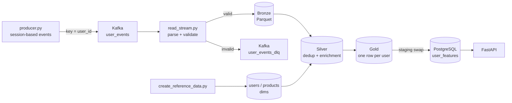

# Real-Time Personalization Pipeline

[](https://github.com/HimanshuLabs/Real-time-personalization-pipeline/actions/workflows/ci.yml)


[](LICENSE)

An end-to-end data pipeline that turns a stream of e-commerce events into per-user personalization features and serves them over an API.

**Kafka → Spark Structured Streaming → Bronze → Silver → Gold → PostgreSQL → FastAPI**, with a dead-letter topic, an atomic serving-table swap, Airflow orchestration and Prometheus/Grafana monitoring. Everything runs locally with Docker; the events are synthetic.

> Streaming ingestion lands and validates events continuously. Features are computed in batch and published atomically, so the API always reads a complete, consistent table.

## Highlights

- **Realistic synthetic sessions.** The generator runs up to 20 concurrent user sessions. Each session follows one user and one product through a purchase funnel (entry, search, product views, cart, checkout, payment, order), with catalog prices in INR fixed for the session. Inactive accounts and inactive products never appear in the stream.
- **No silent data loss.** Every event lands in exactly one place: Bronze if valid, the dead-letter topic if not. Malformed timestamps and NULLs are routed to the DLQ instead of crashing the stream or vanishing.
- **Lossless Bronze, dedup in Silver.** Bronze keeps every valid event; duplicates are removed by `event_id` in Silver, so no late event is ever dropped.
- **Spend, session and recency features.** Gold adds `total_spend`, `session_count` and `recency_hours` to the per-user counts. Price features cover commerce events only, and averages are computed on DECIMAL, so rerunning Gold on the same Silver gives identical values.
- **Atomic publishing.** Gold is written to a staging table, validated (non-empty, unique `user_id`) and swapped into the live table in one PostgreSQL transaction. A failed publish leaves the old table untouched.
- **Graceful operations.** Ctrl+C stops the stream cleanly in about a second, and a restart resumes from its checkpoint with no duplicates or gaps. Kafka and PostgreSQL data persist on Docker volumes.
- **Contracts enforced by tests.** 69 tests run the real Spark scripts on small datasets and check exact results, plus the event schema, session and funnel rules, validation rules and API behaviour. CI runs them on every push to `main` and on pull requests.
- **Observable.** Prometheus scrapes the API and two exporters; Grafana shows request rate, latency, Kafka throughput, DLQ rate and feature freshness.

## Architecture



| Stage | Code | Output |
|---|---|---|
| Event generation | `data-generator/producer.py` | Kafka `user_events` (3 partitions, keyed by `user_id`) |
| Validation and landing | `spark-streaming/read_stream.py` (via `scripts/run_stream.sh`) | `data/bronze/user_events`, Kafka `user_events_dlq` |
| Reference data | `reference-data/create_reference_data.py` | `data/dim/users`, `data/dim/products` |
| Dedup and enrichment | `spark-batch/bronze_to_silver.py` | `data/silver/user_events` |
| User features | `spark-batch/silver_to_gold.py` | `data/gold/user_features` |
| Publish | `spark-batch/publish_gold_to_postgres.py` | PostgreSQL `user_features` |
| Serving | `api/main.py` | HTTP API |
| Orchestration | `dags/project1_personalization_pipeline.py` | Airflow DAG `project1_personalization_batch_pipeline` |
| Monitoring | `monitoring/run_monitoring.sh` | Prometheus and Grafana |

The full diagram, including monitoring, is in [docs/diagrams/project1_system_architecture.mmd](docs/diagrams/project1_system_architecture.mmd), and component details are in [docs/architecture.md](docs/architecture.md).

## Example run

One end-to-end run, following the quick start below:

| Stage | Result |
|---|---|
| Producers | 3 producer processes for 10 minutes; 2,273 events delivered (756 / 755 / 762) |
| Kafka `user_events` | 2,273 events across 3 partitions (695 / 736 / 842) |
| Dead-letter topic | 0 events: the producer only emits valid events (rejection paths are covered by the validation tests) |
| Bronze | 2,273 rows, 2,273 distinct `event_id`s, from 400 users in 413 sessions |
| Silver | 2,273 rows, 0 missing user references, 0 missing product references |
| Gold and PostgreSQL | 400 users, one row each; PostgreSQL matches Gold exactly |
| Purchases | 21 (about 5.1% of sessions) |
| Total spend | 449,892.11 INR, the same in Silver, Gold and PostgreSQL |
| Browse-only users | 14 users with no commerce event, so their price features are NULL |
| API | `/health` 200; `/features/{id}` 200 (including `total_spend`, `session_count` and `recency_hours`), 404 and 422 as specified |

The stream ran until its checkpoint matched Kafka's end offsets, then stopped cleanly.

Counts vary from run to run, because the producer generates random sessions.

### See the dead-letter topic in action

With the stream running, send a malformed event and watch it land in `user_events_dlq` instead of Bronze:

```bash
echo '{"event_id":"demo-bad-1","event_time":"not-a-date"}' | docker exec -i kafka /opt/kafka/bin/kafka-console-producer.sh --bootstrap-server localhost:9092 --topic user_events
sleep 15
docker exec kafka /opt/kafka/bin/kafka-get-offsets.sh --bootstrap-server localhost:9092 --topic user_events_dlq
```

One partition of `user_events_dlq` goes up by 1.

## Tech stack

| Layer | Technology |
|---|---|
| Messaging | Apache Kafka 4.1.2 (KRaft, single broker) |
| Processing | Apache Spark 4.1.2 (Structured Streaming and batch), Parquet |
| Serving | PostgreSQL 16, FastAPI 0.115, psycopg 3 |
| Orchestration | Apache Airflow 3.2 |
| Monitoring | Prometheus 3.5, Grafana 13, kafka-exporter 1.10, custom feature-freshness exporter |
| Quality | pytest, Ruff, GitHub Actions |
| Runtime | Docker Compose, Python 3.11+, Java 17 |

## Quick start

Requirements: Docker, Java 17 and Python 3.11 or newer. Run everything from the repository root.

```bash
python -m venv venv
source venv/bin/activate
pip install -r requirements-ci.txt -r api/requirements.txt
```

1. Start Kafka (`127.0.0.1:9092`) and PostgreSQL (`127.0.0.1:5433`):

   ```bash
   docker compose up -d
   ```

2. Create both topics with 3 partitions:

   ```bash
   docker exec kafka /opt/kafka/bin/kafka-topics.sh --bootstrap-server localhost:9092 --create --if-not-exists --topic user_events --partitions 3 --replication-factor 1
   docker exec kafka /opt/kafka/bin/kafka-topics.sh --bootstrap-server localhost:9092 --create --if-not-exists --topic user_events_dlq --partitions 3 --replication-factor 1
   ```

3. Start the stream in its own terminal (stop it with Ctrl+C):

   ```bash
   scripts/run_stream.sh
   ```

4. Produce events in another terminal (stop with Ctrl+C; it prints a `delivered / failed / undelivered` summary):

   ```bash
   python data-generator/producer.py
   ```

5. Build the reference data, Silver and Gold:

   ```bash
   spark-submit reference-data/create_reference_data.py
   spark-submit spark-batch/bronze_to_silver.py
   spark-submit spark-batch/silver_to_gold.py
   ```

6. Publish to PostgreSQL:

   ```bash
   spark-submit --packages org.postgresql:postgresql:42.7.4 spark-batch/publish_gold_to_postgres.py
   ```

7. Start the API and query it:

   ```bash
   uvicorn api.main:app --host 127.0.0.1 --port 8000
   curl http://127.0.0.1:8000/health
   ```

   Then call `GET /features/{user_id}` for any `user_id` in `user_features`.

8. Start monitoring (optional). Prometheus runs at `127.0.0.1:9090` and Grafana at `127.0.0.1:3000`; `monitoring/stop_monitoring.sh` removes the containers.

   ```bash
   monitoring/run_monitoring.sh
   ```

The batch scripts use paths relative to the current directory, so run them from the repository root. `spark-batch/query_gold_features.py` runs a few example queries on Gold.

## How it works

### Synthetic events

`data-generator/producer.py` keeps up to 20 sessions active (`MAX_ACTIVE_SESSIONS`). Each loop picks one active session at random, emits its next event with the current UTC time, and replaces a finished session with a new one. A session belongs to one user (within one producer process, a user has at most one active session at a time), shares one `session_id` across its events, and follows one product, whose price is fixed for the session.

Each session follows this funnel, one event per step:

1. `login` (30%) or `home_page_view` (70%); after `home_page_view`, sometimes `ad_impression` (20%), then sometimes `ad_click` (25% of impressions).
2. `search` (50%), with a query that fits the session's category.
3. One to three `product_view`s. Each may be preceded by `recommendation_impression` → `recommendation_click` (25%) and followed by `image_zoom` (20%) or `wishlist_add` (5%; half of those sessions stop there).
4. `add_to_cart` (18% of sessions, quantity 1 to 3). Then either `remove_from_cart` (10% of carts; the session stops) or `checkout_started` (60% of the remaining carts).
5. After checkout: `coupon_applied` (20%), then `payment_initiated`, then `payment_success` + `order_placed` (85%) or `payment_failed`. After an order, sometimes `review_submitted` or `rating_given` (5%).
6. `logout` ends 40% of sessions.

Products and prices:

- **Catalog:** 29 products in 8 categories; `product_id` is fixed per product (the sorted product names are numbered from 10000).
- **Prices:** every product has a fixed list price in `PRODUCT_REFERENCE_PRICES` (INR; the events carry no currency field), inside its category's band in `CATEGORY_PRICE_BANDS`. A session's `original_price` is the list price × 0.9 to 1.1. Its `discount_percent` is 0–15% in 85% of sessions and 15–40% otherwise.
- **Product fields:** `PRODUCT_FIELDS` (`product_id`, `product_name`, `category`, `quantity`, `original_price`, `discount_percent`, `discounted_price`, `cart_value`) are NULL on non-commerce events. On commerce events, `quantity` is 1 until `add_to_cart` and the cart quantity from then on. `cart_value` = `discounted_price × quantity` is set only on cart events (`add_to_cart`, `remove_from_cart`, `checkout_started`, `payment_initiated`, `payment_success`, `payment_failed`, `order_placed`).
- **Status:** `producer.py` defines `account_status` (1 account in 25 is inactive; 231 of 5,000) and `is_product_active` (`product_id % 20 != 0`; `air_fryer` and `perfume` are inactive). The reference dims use the same functions. The producer never starts a session for an inactive account and never picks an inactive product.

Other fields follow the session and user state:

- `recommendation_rank`, `recommendation_clicked` and `recommendation_algorithm` are set only on recommendation events; a click repeats the rank and algorithm of its impression. `click_position` is set only on clicks.
- `search_query` is set only on `search` events.
- `time_since_last_event_ms` is the real gap since the same user's previous event. It is NULL on a user's first event since the producer started, and for a gap too large for Bronze's 32-bit column.
- `session_duration_sec` counts seconds since the session's first event; `items_viewed_in_session` and `repeat_product_view_count` count the session's product views so far.
- `purchase_probability` is a logistic function of the funnel stage plus small noise, so it rises from browsing to payment and stays strictly between 0 and 1.
- `city` is the user's `home_city` on about 85% of events, and `country` is `"United States"` on about 95%.
- `inventory_remaining` is a per-product stock level (starting at 50 to 500) that drops by the cart quantity on `payment_success` and is restocked once it falls below 5. It is NULL on non-commerce events.
- `user_journey_stage` follows the event type (`JOURNEY_STAGE_BY_EVENT_TYPE`): `discovery` for `home_page_view`, `login`, `search`, `ad_impression` and `ad_click`; `consideration` for product views, `image_zoom`, `wishlist_add` and recommendation events; `checkout` from `add_to_cart` through the payment events; `post_purchase` for `order_placed`, `review_submitted` and `rating_given`. `logout` keeps the session's latest stage. The `comparison` value in `USER_JOURNEY_STAGES` is never emitted.
- `device_type`, `operating_system`, `browser`, `network_type` and `app_version` are drawn once per session and fit together: mobile and tablet run `android` or `ios` on `wifi`, `4g` or `5g`; desktop runs `windows`, `macos` or `linux` on `wifi` or `ethernet`; `safari` appears only on `ios` and `macos`.
- `payment_method` is drawn once per session and set only on `payment_initiated`, `payment_success`, `payment_failed` and `order_placed` (`PAYMENT_EVENT_TYPES`); it is NULL on every other event.

**Event types.** The stream accepts all 26 types in `EVENT_TYPES`. The producer emits 21 of them: `home_page_view`, `login`, `logout`, `search`, `ad_impression`, `ad_click`, `product_view`, `image_zoom`, `wishlist_add`, `recommendation_impression`, `recommendation_click`, `add_to_cart`, `remove_from_cart`, `checkout_started`, `coupon_applied`, `payment_initiated`, `payment_success`, `payment_failed`, `order_placed`, `review_submitted` and `rating_given`.

`COMMERCE_EVENT_TYPES`, the events that concern a product, are `product_view`, `image_zoom`, `wishlist_add`, `wishlist_remove`, `add_to_cart`, `remove_from_cart`, `checkout_started`, `payment_initiated`, `payment_success`, `payment_failed`, `order_placed`, `order_cancelled`, `return_requested`, `review_submitted`, `rating_given`, `recommendation_impression`, `recommendation_click` and `search_result_click`. Tests keep `EVENT_TYPES` and `COMMERCE_EVENT_TYPES` identical in the producer and the stream, and `COMMERCE_EVENT_TYPES` identical in Gold.

<details>
<summary><b>Example event</b> (schema 4.0, an <code>add_to_cart</code> produced by <code>generate_event()</code>)</summary>

```json
{
  "event_id": "17d6fbd9-ca5d-4b3f-a041-776ed0a1d6c2",
  "session_id": "338109cf-e8c1-4244-b9de-99949a2d5959",
  "user_id": 782,
  "user_name": "Dawn Hunt",
  "email": "qnguyen@example.com",
  "gender": "other",
  "age": 25,
  "membership_tier": "plus",
  "loyalty_points": 20898,
  "preferred_language": "kannada",
  "home_city": "Masonburgh",
  "home_state": "Illinois",
  "event_time": "2026-11-11T07:09:53.610454+00:00",
  "event_type": "add_to_cart",
  "user_journey_stage": "checkout",
  "user_segment": "loyal_customer",
  "is_prime_user": false,
  "product_id": 10001,
  "product_name": "atomic_habits",
  "category": "books",
  "quantity": 1,
  "original_price": 525.38,
  "discount_percent": 0.66,
  "discounted_price": 521.91,
  "cart_value": 521.91,
  "inventory_remaining": 494,
  "search_query": null,
  "time_on_page_sec": 64.65,
  "scroll_depth_percent": 42,
  "hover_duration_ms": 12580,
  "session_duration_sec": 17,
  "items_viewed_in_session": 2,
  "repeat_product_view_count": 2,
  "time_since_last_event_ms": 15172,
  "recommendation_rank": null,
  "recommendation_clicked": null,
  "recommendation_algorithm": null,
  "click_position": null,
  "engagement_score": 4.25,
  "purchase_probability": 0.3436,
  "cart_abandonment_probability": 0.8169,
  "ab_test_group": "A",
  "payment_method": null,
  "device_type": "tablet",
  "operating_system": "android",
  "browser": "chrome",
  "network_type": "4g",
  "app_version": "1.9",
  "traffic_source": "instagram_ads",
  "campaign_id": 7893,
  "api_latency_ms": 91,
  "page_load_time_ms": 5176,
  "fraud_score": 0.2179,
  "country": "United States",
  "city": "Masonburgh",
  "ip_address": "62.105.10.253",
  "schema_version": "4.0",
  "source": "real-time-personalization-generator"
}
```

</details>

### Streaming ingestion and validation

`scripts/run_stream.sh` starts `spark-streaming/read_stream.py` with the Spark Kafka connector (`spark-sql-kafka-0-10_2.13:4.1.2`). The stream reads `user_events` (from the earliest offset on first start, then from its checkpoint), parses each message with a typed schema and routes it every 10 seconds:

- **Valid** events are appended to Bronze Parquet with their 58 fields plus `event_timestamp`.
- **Invalid** events are written to `user_events_dlq` as their original JSON.

An event is valid only if all of these hold:

- **Required fields:** `event_id`, `session_id`, `user_id`, `event_type`, `event_time`, `source` and `schema_version` are present.
- **Timestamp:** `event_time` parses (`try_to_timestamp`; a malformed value becomes NULL and fails the check instead of stopping the stream).
- **Contract:** `event_id` is not blank, `event_type` is one of the 26 `EVENT_TYPES`, `schema_version` is `"4.0"`, and `user_id >= 1`.
- **Scores:** `purchase_probability`, `cart_abandonment_probability` and `fraud_score` are each between 0 and 1.
- **Product and price fields:** the rules are `quantity >= 1`, `original_price >= 0`, `discounted_price >= 0`, `discounted_price <= original_price` and `0 <= discount_percent <= 100`.
  - **Commerce events** (`COMMERCE_EVENT_TYPES`) must have `product_id`, `product_name`, `original_price` and `discounted_price`, and every rule must hold (a NULL `quantity` or `discount_percent` fails its rule).
  - **Other events** may leave product and price fields NULL; a value that is present must pass the same rules.

All rules feed one `is_valid` column wrapped in `coalesce(..., false)`, so a NULL in any checked column, or a message that isn't valid JSON, goes to the DLQ instead of disappearing from both outputs.

### Batch feature computation

1. **Reference data:** `create_reference_data.py` builds the users dim (`user_id` 1..`NUM_USERS`) and the products dim (the producer's catalog) from the producer's own profiles, catalog, list prices and status functions, so every id the producer can emit has a reference row. Derived columns use fixed seeds, so the output is identical on every run.
2. **Silver:** `bronze_to_silver.py` drops rows missing `user_id`, `event_type` or `event_timestamp`, removes duplicate `event_id`s, left-joins both dims and keeps the event's own `user_segment`. `is_user_reference_missing` flags users without a dim row; `is_product_reference_missing` flags events that have a `product_id` without a dim row, so non-commerce events are never flagged.
3. **Gold:** `silver_to_gold.py` aggregates Silver to one row per `user_id`. Price features use commerce events only. Averages and `total_spend` are computed on DECIMAL, rounded half up and stored as DOUBLE, so the result doesn't depend on the order Spark adds the rows. One `features_computed_at` timestamp is taken per run, and `recency_hours` is measured against it.
4. **Publish:** `publish_gold_to_postgres.py` writes Gold to `user_features_staging` over JDBC, then in one transaction checks that staging is non-empty with unique `user_id`s, adds the primary key, drops `user_features`, renames staging to `user_features` and renames the key to `user_features_pkey`. Any failure rolls back and leaves the live table as it was. Queries already running finish first, because the swap waits for their locks; queries that arrive during the swap wait for its brief lock and then read the new table.

Every Spark job runs with `spark.sql.session.timeZone=UTC`. The Airflow DAG `project1_personalization_batch_pipeline` runs these steps daily with `max_active_runs=1`:
`verify_bronze_exists → create_reference_data → bronze_to_silver → verify_silver_exists → silver_to_gold → verify_gold_exists → gold_to_postgres → verify_postgres_api_path`.

### Feature table: PostgreSQL `user_features`

| Column | Type | Meaning |
|---|---|---|
| `user_id` | integer | primary key (`user_features_pkey`) |
| `user_name` | text | from the user's latest event |
| `membership_tier` | text | from the user's latest event |
| `total_events` | bigint | all events |
| `page_view_count` | bigint | `home_page_view` events |
| `product_view_count` | bigint | `product_view` events |
| `add_to_cart_count` | bigint | `add_to_cart` events |
| `purchase_count` | bigint | `payment_success` events |
| `search_count` | bigint | `search` events |
| `avg_event_price` | double precision | average `discounted_price` over commerce events, 2 decimals; NULL for a user without commerce events |
| `max_event_price` | double precision | highest `discounted_price` over commerce events, 2 decimals; NULL for a user without commerce events |
| `avg_engagement_score` | double precision | over all events, 2 decimals |
| `avg_purchase_probability` | double precision | over all events, 4 decimals |
| `last_event_timestamp` | timestamp with time zone | latest event time |
| `unique_products_interacted` | bigint | distinct product names (0 for a user without commerce events) |
| `total_spend` | double precision | sum of `cart_value` over `payment_success` events, 2 decimals; 0 if none |
| `session_count` | bigint | distinct `session_id`s |
| `features_computed_at` | timestamp with time zone | when the Gold run computed the features; the same for every row |
| `recency_hours` | double precision | hours from `last_event_timestamp` to `features_computed_at`, 2 decimals |

### API

| Endpoint | Status | Body |
|---|---|---|
| `GET /` | 200 | service message |
| `GET /health` | 200 | `{"status": "healthy", "postgres": "connected"}` |
| `GET /health` | 503 | `{"detail": "database unavailable"}`, `"user_features missing"` or `"user_features empty"` |
| `GET /features/{user_id}` | 200 | `{"user_id": ..., "features": {...}}` |
| `GET /features/{user_id}` | 404 | `{"detail": "No features found for user_id=<id>"}` |
| `GET /features/{user_id}` | 422 | `user_id` is not an integer |
| `GET /features/{user_id}` | 500 | `{"detail": "Feature lookup failed"}` |
| `GET /metrics` | 200 | Prometheus metrics |

`features` contains every column above except `user_name`, `membership_tier` and `features_computed_at`. That is `user_id`, the six counts, `avg_event_price`, `max_event_price`, `last_event_timestamp`, `unique_products_interacted`, `avg_engagement_score`, `avg_purchase_probability`, `total_spend`, `session_count` and `recency_hours`. Error responses never include exception text; details are logged server-side.

## Configuration

| Variable | Default | Used by |
|---|---|---|
| `POSTGRES_HOST` | `localhost` | API, publish job, DAG verification task, feature-freshness exporter |
| `POSTGRES_PORT` | `5433` | same as above |
| `POSTGRES_DB` | `personalization_db` | same as above |
| `POSTGRES_USER` | `de_user` | same as above |
| `POSTGRES_PASSWORD` | `de_password` | same as above |
| `PROJECT1_ROOT` | the repository root | `read_stream.py` (Bronze and checkpoint paths), Airflow DAG (task working directory) |
| `NUM_USERS` | `5000` | `producer.py` and `create_reference_data.py`; use the same value for both |
| `SPARK_KAFKA_VERSION` | `4.1.2` | `scripts/run_stream.sh` (Spark Kafka connector version) |
| `GRAFANA_ADMIN_PASSWORD` | generated and printed once if unset | `monitoring/run_monitoring.sh` |

The feature-freshness exporter's own default host is `host.docker.internal`; `run_monitoring.sh` starts it with `POSTGRES_HOST=localhost` and `POSTGRES_PORT=5433`. Docker Compose creates the database with the default name, user and password above.

## Operations

- **Stop the stream:** press Ctrl+C (or `kill -TERM -<pgid>`) in the `scripts/run_stream.sh` terminal. Both queries and Spark stop, the stream prints `[stream] stopped cleanly` and exits 0. The script makes the JVM ignore SIGINT/SIGTERM, so the signal reaches only the Python driver, which shuts down in order.
- **Restart the stream:** it resumes from `checkpoints/bronze_user_events` and `checkpoints/dlq`.
- **Reset the stream** (re-read Kafka from the start): stop it, then move **both** `checkpoints/` **and** `data/bronze/user_events` out of the repository. The Bronze folder holds the file sink's own log (`_spark_metadata`); a new checkpoint paired with an old `_spark_metadata` makes the sink skip new batches without an error. After a reset, the DLQ query re-reads the topic too, so invalid events already in the DLQ are written there again.
- **Data persistence:** Kafka data lives on the `kafka_data` volume and PostgreSQL data on `postgres_data`; both survive container recreation. Never run `docker compose down -v`, which deletes both volumes.
- **Airflow:** the DAG's Python dependencies are in `requirements-airflow.txt`. Its tasks call `spark-submit`, so it must be on the worker's PATH.
- **Monitoring:** the Grafana dashboard covers API request rate and p95 latency, `user_events` and DLQ throughput, consumer-group lag, `user_features` row count, feature freshness and exporter health. Spark keeps its Kafka offsets in checkpoints rather than a consumer group, so the consumer-group lag panel normally shows no data; feature freshness is the signal for the batch-to-serving path.

## Design decisions

| Decision | Why |
|---|---|
| Lossless Bronze, dedup in Silver | A streaming watermark with stateful dedup would silently drop late events from the raw layer. |
| One coalesced `is_valid` column | Every event lands in exactly one of Bronze and the DLQ; a NULL can't slip past both filters. |
| Product fields required only on commerce events | Logins, searches and page views carry no product, and a product or price that is present is still checked. |
| Staging-table swap | Readers never see a missing, empty or partially written serving table, and a failed publish changes nothing. |
| Reference dims generated from the producer | Every id the producer emits has a reference row, the dims use the producer's list prices and status rules, and rebuilding them is deterministic. |
| Averages on DECIMAL | Rounding doesn't depend on the order Spark adds the rows, so the same Silver always gives the same Gold. |
| Spark sessions in UTC | Timestamps mean the same thing on every machine; PostgreSQL stores `timestamp with time zone`. |
| Signals handled by the Python driver only | A terminal Ctrl+C stops the queries in order instead of killing the JVM mid-batch. |

## Testing and CI

```bash
ruff check .
python -m pytest -q
```

| File | Tests | Covers |
|---|---:|---|
| `tests/test_batch_pipeline.py` | 10 | the real reference, Silver and Gold scripts on a tiny Bronze: duplicate removed, event `user_segment` kept, no Silver `price` column, product-reference flag only for an unknown product, Gold schema (15 columns plus 4 at the end), commerce-only and DECIMAL-rounded price features, exact `total_spend`, `session_count` and `recency_hours`, dim status equal to the producer's functions |
| `tests/test_stream_validation.py` | 14 | each validation rule routes to the DLQ, a login without product fields is valid, a commerce event without a product is not, valid + invalid = input, Bronze/DLQ columns unchanged, importing the stream module starts no Spark |
| `tests/test_feature_api.py` | 9 | API with a mocked database: found / 404 / 500 / 503 reasons, new and existing fields selected, no credentials or exception text in responses, `POSTGRES_*` honoured, `user_id` typed as int |
| `tests/test_producer_contract.py` | 31 | 58 keys in order, schema 4.0, catalog prices and bands, product fields NULL on non-commerce events, one user, product and price per session, funnel order, field consistency rules, journey stage by event type, device context fixed and consistent per session, `payment_method` only on payment events, no inactive account or product, no Kafka connection on import |
| `tests/test_project_structure.py` | 4 | required files exist, runtime folders are git-ignored, `EVENT_TYPES` and `COMMERCE_EVENT_TYPES` match across the producer, stream and Gold |
| `tests/test_python_syntax.py` | 1 | every Python file parses |

GitHub Actions (`.github/workflows/ci.yml`) runs on every push and pull request to `main`:
- **Python lint and validation:** Python 3.11 and Java 17 (Temurin), `requirements-ci.txt`, `ruff check .` and `pytest -q`.
- **FastAPI Docker build validation:** builds `api/Dockerfile`.

## Project structure

```text
.
├── api/                    FastAPI service and Dockerfile
├── dags/                   Airflow DAG for the batch pipeline
├── data-generator/         Kafka event producer
├── docs/                   architecture notes and full diagram
├── monitoring/             Prometheus, Grafana, exporters, start/stop scripts
├── reference-data/         users and products dims
├── scripts/run_stream.sh   stream launcher with clean Ctrl+C handling
├── spark-batch/            Bronze → Silver → Gold → PostgreSQL jobs
├── spark-streaming/        Kafka → Bronze / DLQ streaming job
├── tests/                  pytest suite
└── docker-compose.yml      Kafka and PostgreSQL
```

## Limitations and next steps

| Limitation | Production next step |
|---|---|
| Features are recomputed in batch; the stream doesn't update `user_features`. | Incremental upserts from the stream (`foreachBatch` + `INSERT … ON CONFLICT`) for near-real-time counters. |
| `recency_hours` is computed at batch time against `features_computed_at`, so it grows stale between Gold runs. | Compute recency at request time from `last_event_timestamp`. |
| Every batch run reprocesses all of Bronze. | Incremental processing with a table format such as Delta Lake and `MERGE`. |
| Bronze stores parsed columns, not the raw Kafka payload. | Keep the raw value alongside the parsed columns for full replay. |
| DLQ messages don't record which rule rejected them. | Add the failed rule as a Kafka header on each DLQ message. |
| A session follows one product, so `items_viewed_in_session` and `repeat_product_view_count` always carry the same value. | Let a session browse several products and count views per product. |
| 5 of the 26 event types are never emitted: `search_result_click`, `wishlist_remove`, `order_cancelled`, `return_requested` and `delivery_tracking_view`. | Add funnel steps for them. |
| Some context fields are drawn independently for each event: `traffic_source`, `ab_test_group`, `campaign_id`, `api_latency_ms`, `page_load_time_ms`, `cart_abandonment_probability`, `fraud_score` and `ip_address`. | Keep campaign and experiment fields constant per session and model latency from the device and network. |
| Each producer process keeps its own sessions, stock levels and per-user gaps, so parallel producers don't share them. | Keep that state in a shared store, or run a single producer. |
| Single Kafka broker, replication factor 1. | A multi-broker cluster with replication factor 3. |
| The Airflow DAG is syntax-checked in CI but not executed. | A DAG integrity test and a containerised Airflow in the quick start. |

Security and privacy: this is a local demo with default credentials, and the serving table includes a synthetic `user_name`. A production deployment would use a secrets manager and serve IDs and features only.

## Operational notes

- `scripts/run_stream.sh` makes the JVM ignore SIGINT and SIGTERM so the Python driver can stop the queries in order. If the driver ever hangs, only SIGKILL stops the JVM.
- `product_id`s follow the sorted product names, so adding or renaming a product renumbers them. The dims rebuild on every run, but events already in Bronze keep their old ids.
- The Grafana admin password is passed as an environment variable and is visible through `docker inspect grafana`.
- `postgres:16` and the `python:3.11-slim` / `python:3.12-slim` base images are tagged by major/minor version only.

## License

MIT. See [LICENSE](LICENSE).
